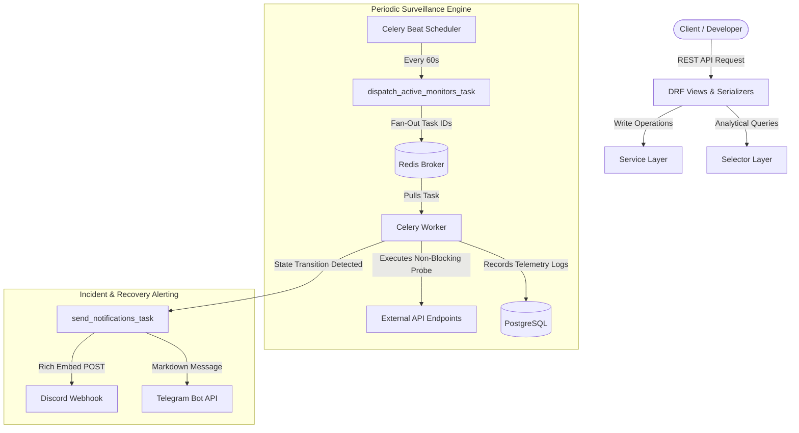

# 🛡️ Aegis Monitor

[](https://github.com/vahiddev7/aegis-monitor/actions/workflows/ci.yml)
[](https://www.python.org/downloads/)
[](https://www.djangoproject.com/)
[](LICENSE)
[](https://github.com/psf/black)

A production-grade, self-hosted API uptime, latency, and incident alerting engine engineered with **Django**, **Django REST Framework (DRF)**, **Celery**, and **Redis**. Built with a strict **Service & Selector Pattern** architecture designed to scale with sub-second health checks and real-time webhook dispatches.

---

## 🏗️ Architecture Overview

The system strictly enforces separation of concerns:
- **Views**: Thin controllers handling authentication and HTTP serialization.
- **Services**: Pure business logic, write operations, and outbound HTTP probes.
- **Selectors**: Read-only queries and single-pass SQL aggregations.
- **Celery Tasks**: Asynchronous probe fan-out and non-blocking alert dispatching.



---

## ✨ Key Features

- **Service & Selector Architecture:** Eliminates fat models and bloated views; isolates domain logic for unit and integration testing.
- **Asynchronous Health Probing:** Scalable fan-out architecture using Celery workers to probe hundreds of endpoints concurrently without blocking API threads.
- **High-Precision Monotonic Latency:** Microsecond-accurate response time measurement using monotonic timers and client connection isolation (`httpx`).
- **Instant Incident Webhooks:** Automated alerts to Discord (rich embed cards) and Telegram (Markdown) triggered exclusively upon state flips (`UP` $\leftrightarrow$ `DOWN`).
- **Database-Optimized Analytics:** Single-pass SQL aggregations (`aggregate()`, `Count`, `Avg`, `Q`) for computing 24-hour uptime percentages and latency trends with zero in-memory iteration.
- **Robust Multi-Stage Dockerization:** Complete development and production Docker Compose setups with PostgreSQL 17, Redis 7, Nginx, Gunicorn, and Flower dashboard.

---

## 📁 Project Structure

```text
aegis-monitor/
├── apps/
│   ├── authentication/        # JWT Authentication, tokens, and throttling
│   ├── core/                  # Base abstract models and utilities
│   ├── monitors/              # Core monitoring and incident alerting domain
│   │   ├── models/            # EndpointMonitor, HealthCheckLog, NotificationChannel
│   │   ├── selectors/         # Fast read queries & analytical aggregations
│   │   ├── services/          # HTTP probe logic & Discord/Telegram dispatchers
│   │   ├── serializers/       # DRF serializers (Input vs Output)
│   │   ├── views/api/v1/      # REST endpoints for monitors and telemetry
│   │   ├── tasks.py           # Celery probe and notification background tasks
│   │   └── tests/             # Pytest unit and integration test suites
│   └── users/                 # Custom user domain model and selectors
├── config/
│   ├── settings/              # Split settings: base, dev, prod, test
│   ├── celery.py              # Celery instance and Beat schedule declarations
│   └── urls.py                # Root routing specification
├── docker/                    # Dockerfiles, entrypoints, and Nginx configurations
├── requirements/              # Split dependency specifications
├── docker-compose.dev.yml     # Local infrastructure (PostgreSQL & Redis)
├── docker-compose.yml         # Production multi-container orchestration
└── manage.py
```

---

## 🚀 Quick Start (Local Development)

### 1. Prerequisites
- Python 3.12+
- Docker and Docker Compose
- Git

### 2. Clone the Repository
```bash
git clone https://github.com/vahiddev7/aegis-monitor.git
cd aegis-monitor
```

### 3. Spin Up Local Infrastructure
Launch PostgreSQL 17 and Redis 7 in the background:
```bash
docker compose -f docker-compose.dev.yml up -d
```

### 4. Setup Python Virtual Environment
```bash
python3.12 -m venv .venv
source .venv/bin/activate
pip install -r requirements/develop.txt
```

### 5. Configure Environment Variables
Copy and adjust environment configuration:
```bash
cp .env.example .env
```
Ensure your database credentials and Redis URLs match:
```ini
DJANGO_SETTINGS_MODULE=config.settings.dev
DB_NAME=aegis
DB_USER=aegis
DB_PASSWORD=wUpJo8zR_XGpqm7NBDEe4JHIryGqoW7G
DB_HOST=127.0.0.1
DB_PORT=5432
CELERY_BROKER_URL=redis://127.0.0.1:6379/0
CELERY_RESULT_BACKEND=redis://127.0.0.1:6379/1
```

### 6. Apply Migrations & Launch Dev Server
```bash
python manage.py migrate
python manage.py runserver
```

### 7. Run Celery Workers & Beat Scheduler
Open two separate terminal sessions:
```bash
# Terminal 1: Celery Worker
celery -A config worker -l info

# Terminal 2: Celery Beat Scheduler (triggers checks every 60s)
celery -A config beat -l info
```

---

## 📡 Core API Endpoints

| Method | Endpoint | Description |
|---|---|---|
| `GET` | `/api/v1/monitors/` | List all monitors owned by authenticated user |
| `POST` | `/api/v1/monitors/` | Register a new endpoint monitor |
| `GET` | `/api/v1/monitors/{id}/` | Retrieve monitor configuration and channel details |
| `GET` | `/api/v1/monitors/{id}/metrics/` | Aggregated 24h uptime ratio & average latency |
| `GET` | `/api/v1/monitors/{id}/logs/` | Paginated historical health check logs |

### Example: Creating a Monitor
```bash
curl -X POST http://127.0.0.1:8000/api/v1/monitors/ \
  -H "Authorization: Bearer <YOUR_ACCESS_TOKEN>" \
  -H "Content-Type: application/json" \
  -d '{
    "name": "Production Payment Gateway",
    "url": "https://api.stripe.com/healthz",
    "http_method": "GET",
    "expected_status_code": 200,
    "interval_seconds": 60,
    "timeout_seconds": 10
  }'
```

---

## 🧪 Testing

The test suite uses `pytest` with network isolation (`httpx` mocking) and database rollback:

```bash
# Run monitor test suite
pytest apps/monitors/tests/ -v

# Run full project test suite with coverage
pytest --cov=apps
```

---

## 📄 License

This project is licensed under the MIT License - see the [LICENSE](LICENSE) file for details.